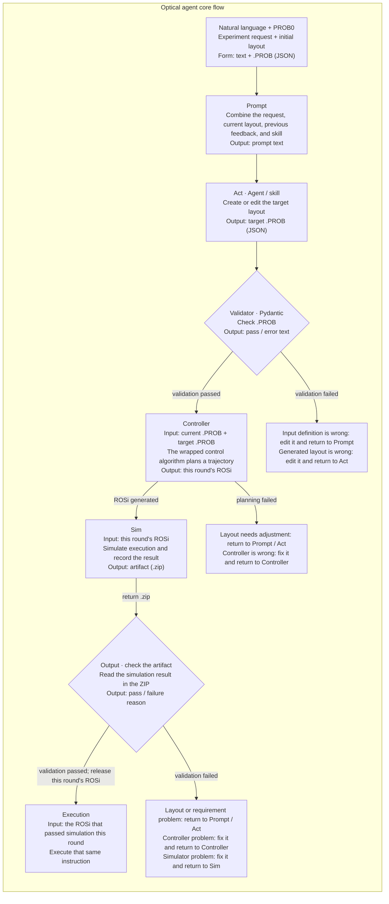

# Optical agent core flow

Start from a natural-language experiment request and an initial layout. Generate a target layout. After validation, trajectory planning, and simulation, execute the same instruction that passed validation for this round.

## Data and instructions

| Name | Meaning |
|---|---|
| PROB0 | Initial layout, represented as .PROB (JSON) |
| Target layout | Target layout created or edited by the agent or skill |
| ROSi | Instruction generated by the controller for this round |
| Artifact | ZIP result package written by the simulator |

## Failure feedback

- Validation failure: edit the input definition or the target layout, depending on the cause, and return to Prompt or Act.
- Planning failure: adjust the layout, or fix the controller and plan again.
- Simulation-validation failure: return to Prompt, Act, Controller, or Sim, depending on the cause.
