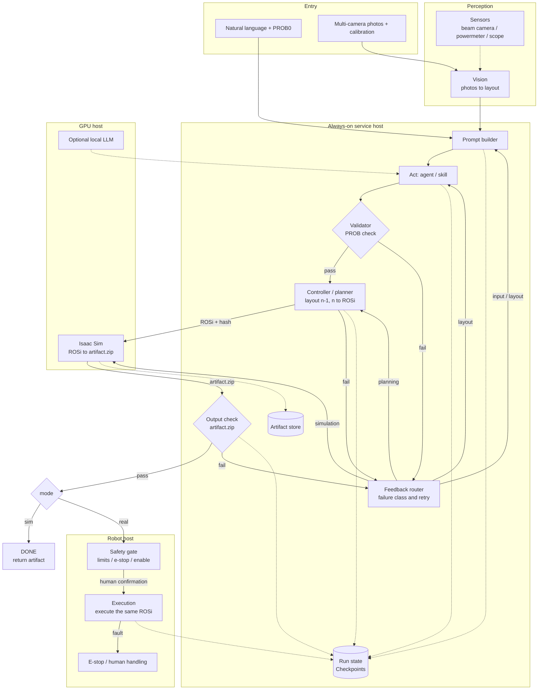

# Agent loop hardware realization

**Status:** Draft v0
**Scope:** Put the core flow of the optical lab agent onto the laboratory hardware system
**Upstream:** [2026-11-02-optical-agent-flow.md](./2026-11-02-optical-agent-flow.md)

## 1. Goal

Take the existing agent flow:

```
natural language + PROB0 → Prompt → Act → Validator → Controller → Sim → Output → Execution
```

onto the real network, hosts, sensors, and robot arm, so that:

- The agent loop and the orchestrator are one always-on service, running on the service host.
- The GPU workstation runs only Isaac, vision inference, and an optional local LLM.
- The robot host runs only the executor and the safety gate. It does not run orchestration.
- The sensor host only acquires data. It does not take part in flow decisions.
- Sim and Execution use the same ROSi. After Output passes, replanning is not allowed.
- Every failure returns, by the original flow, to Prompt, Act, Controller, or Sim. It does not touch the robot arm directly.

## 2. Entry and scope

Two entries are supported:

1. `entry=nl`: a natural-language experiment request plus PROB0, the initial layout.
2. `entry=images`: multi-camera photos plus camera calibration, then the vision toolkit, then PROB0, then the core flow.

Boundary:

- This document only defines how the agent loop lands on hardware and the network. It does not define the optical alignment algorithm, robot-arm kinematics, or UI design.
- Upper tools, including FAT and PCT, may call only the orchestrator API. They cannot reach the robot arm, cameras, or sensors directly.
- Real execution requires a person to confirm it. The agent cannot close the loop onto real motion by itself.

## 3. Integrated flow



Notes:

- `Validator` checks the layout or PROB. It produces no hardware motion.
- `Output` checks `artifact.zip`. It produces no hardware motion.
- `mode=sim` ends after Output passes and returns the artifact.
- `mode=real` enters the safety gate after Output passes. Execution starts only after a person confirms it.
- Execution runs only the same ROSi that already passed validation. A failure is not retried automatically.

## 4. Node mapping

| Flow node | Software | Where it runs | Interface / data | Failure goes to |
|---|---|---|---|---|
| Natural language + PROB0 | CLI / web / upper tool | User machine or the service-host entry | `POST /v1/pipelines/agent-loop/runs`, JSON input plus PROB0 | Input validation failure returns immediately |
| Prompt | Prompt builder inside the orchestrator | Service host | Reads the current layout, previous feedback, and skill; writes prompt text | Mark the run failed and alert |
| Act | Agent / skill, which may call an LLM | Service host; a local LLM runs on the GPU host | Output is the target layout, PROB or JSON | Back to Prompt or Act |
| Validator | Pydantic / JSON Schema | Service host, as a library or an internal service | Input is the target layout; output is pass or an error description | Back to Prompt or Act |
| Controller | Planner, toolkit A | Service host, separate container | Input is layout n-1 plus layout n; output is ROSi plus the plan hash | Back to Prompt, Act, or Controller |
| Sim | Isaac Sim headless | GPU host | Input is ROSi; output is artifact.zip | Back to Prompt, Act, Controller, or Sim |
| Output | Artifact checker | Service host | Reads the ZIP and checks the manifest, plan hash, and simulation result | Back to Prompt, Act, Controller, or Sim |
| Execution | Arm service | Robot host | Input is the same ROSi plus its hash; runs after the safety gate | E-stop or human handling. No automatic retry |
| Vision, optional entry | Vision toolkit | GPU host or sensor host | Multi-view photos plus calibration produce a layout | Back to input or Prompt |
| Sensors, optional check | Sensor service | Sensor host | Beam camera, powermeter, and scope readings | Record and alert. Do not change the flow directly |

## 5. Deployment and network

### 5.1 Node roles

| Node | Hardware suggestion | Runs | Does not run |
|---|---|---|---|
| Router / firewall | VLAN, DHCP reservation, ACL; Tailscale is useful | Subnets, firewall, NAT, remote access | No application services |
| Managed switch | At least 8 ports, VLAN, IGMP snooping, jumbo frames; a 2.5G uplink is useful | Wired aggregation, PoE when needed | Do not use an unmanaged switch |
| Service host | Fanless mini host, N100 or N305, 16–32 GB RAM, 1 TB NVMe, dual 2.5GbE | Orchestrator, agent loop, Validator, planner, database, artifact store, Caddy, Tailscale subnet router | Isaac, large vision models, USB capture, real-time arm control |
| GPU host | RTX 4060 8 GB to start for a small scene; 16 GB VRAM and 64 GB RAM for a complex scene | Isaac Sim, vision inference, optional local LLM | No orchestration and no run state |
| Sensor host | Fanless small host, enough USB 3 ports, 2.5GbE | Camera and sensor capture, device names, watchdog | No GPU work and no orchestration |
| Robot host | Vendor controller, or a separate host plus a ROS 2 bridge | Arm service, safety gate, e-stop, ROS 2 | No agent and no Sim |

### 5.2 Network topology

```
Tailscale user / CLI
        |
Router / firewall (VLAN 10/20/30/40)
        |
Managed switch
  ├── Service host: orchestrator / planner / database / artifact
  ├── GPU host: Isaac / vision / optional LLM
  ├── Robot host: arm service / safety gate / ROS 2
  └── Sensor host: cameras / powermeter / scope
```

Suggested VLANs:

| VLAN | Use | Members | Access |
|---|---|---|---|
| 10 | Management | Router, switch, service host, access point | Administrators only |
| 20 | Devices and robot arm | Service host, robot host, sensor host | No public-internet egress; only the orchestrator may access it |
| 30 | Vision | GPU host, GigE cameras | Jumbo frames; only the orchestrator and vision may access it |
| 40 | Users | Laptops, phones, Wi-Fi access point | May reach only orchestrator port 8000 |

Network requirements:

- Bind services to the Tailscale address or to `127.0.0.1`. Do not open a port to the public internet.
- The user network cannot reach the robot arm or the sensors directly. It goes through the orchestrator.
- Align every host with NTP or chrony. Use PTP or a hardware trigger when tighter sync is required.
- Cameras and the robot arm use Ethernet. Wi-Fi is only for people and low-bandwidth devices.

### 5.3 Service ports

| Service | Port | Host | Exposure |
|---|---|---|---|
| Orchestrator / agent loop | 8000 | Service host | Users reach it through Tailscale |
| Vision | 8101 | GPU or sensor host | Orchestrator only |
| Planner (Controller) | 8102 | Service host | Orchestrator only |
| Sim (Isaac) | 8103 | GPU host | Orchestrator only |
| Arm | 8104 | Robot host | Orchestrator only; local safety gate |
| Sensors | 8105 | Sensor host | Orchestrator only |
| Artifact | 8106 | Service host | Orchestrator and authorized users |
| Optional local LLM | 8107 | GPU host | Orchestrator only |

Validator should be a library inside the orchestrator and should not take its own port. Every service uses the same Job API: `POST /v1/jobs`, `GET /v1/jobs/{id}`, `/healthz`, `/version`, `/openapi.json`.

## 6. Data contracts

One directory per run:

```
/data/runs/<run_id>/
  input/
    prob0.json
    images/
  prompt.txt
  target_layout.json
  plan.json            # ROSi
  plan.sha256
  sim/
    artifact.zip
    manifest.json
  execution/
    result.json
  run.json
  logs/
```

Important fields:

- Layout or PROB: matches unified layout schema v0 and carries `schema_version` and `calibration_id`.
- ROSi or plan: carries `robot_model_id`, `calibration_id`, `tool_frame`, waypoints, limits, and `plan_hash`.
- artifact.zip manifest: `sim_version`, `scene_id`, `robot_model_id`, `calibration_id`, `plan_hash`, simulation result, and logs.
- run.json: status, attempt count, errors, human-confirmation record, and timestamps.
- Large files are passed as URIs (`run://<run_id>/...`). Do not put images or trajectories inside JSON.

Reject a version mismatch directly. Do not convert it implicitly. A layout-schema or plan-format change must bump the version and be announced.

## 7. State machine and feedback

Suggested states:

```
RECEIVED → PROMPTED → ACTED → VALIDATED → PLANNED → SIMMED → VERIFIED
        → AWAITING_APPROVAL (real) → EXECUTING → DONE
```

Any failed step enters `FAILED` or returns to the feedback router. `mode=sim` goes directly to `DONE` after `VERIFIED`.

| Failure source | Returns to | Hardware motion | Suggested retry limit |
|---|---|---|---|
| Validator check failed | Prompt / Act | None | 2 |
| Controller planning failed | Prompt / Act / Controller | None | 2 |
| Sim failed | Prompt / Act / Controller / Sim | None | 2 |
| Output check failed | Prompt / Act / Controller / Sim | None | 2 |
| Network or service timeout | Retry the current stage | None; the arm does not accept a duplicate or expired instruction | 2 |
| Execution fault | E-stop / human | Stop immediately | 0, no automatic retry |

Rules:

- Each stage uses `idempotency_key = run_id + stage + attempt`, so the same work is not executed twice.
- Write a checkpoint on every state change. After a service restart, resume from the last checkpoint.
- A budget caps the total retry count. After the budget, hand the run to a person. Do not loop forever.
- Keep the original output and logs for every failure. What is fed back to Prompt must be traceable.

## 8. Sim / real parity and safety

This is the most important rule in the system:

- After the controller writes a ROSi, Sim and Execution must use the same file and the same hash.
- Replanning is not allowed after Output passes. If the plan file changes, the hash does not match and the arm must refuse to execute.
- The robot model, tool frame, limits, and calibration id in Sim must match the real system. If they do not, the artifact is invalid.
- `mode=real` requires all four of: human confirmation, a local arm enable, a physical e-stop, and a watchdog.
- An expired plan, for example one older than 24 hours, is rejected by default. It can be executed only after it is validated again.
- Execution only records the actual result. It does not automatically turn a failure into a new motion command. A person decides the next round.

## 9. Minimum hardware

| Tier | Configuration | What it can do |
|---|---|---|
| Development | Laptop with an RTX 4060 8 GB, real Isaac for a small scene, and a one-time mock | Integrate the flow and debug the state machine. No real motion |
| Smallest lab | Router or firewall, 8-port managed switch, service host (N100, 16 GB), sensor host, GPU host (4060 8 GB), robot controller, and a UPS | Real Isaac, real planner, and real vision, verified up to but not including Execution, plus an arm dry-run |
| Recommended | 16 GB GPU VRAM, 64 GB RAM, 2.5 or 10GbE, NAS, and a separate sensor host | Complex scenes, multiple cameras, long data generation, and a stable loop |

Note: an RTX 4060 with 8 GB is below the 16 GB VRAM that Isaac Sim officially suggests. It is suitable only for a small scene. Use 16 GB for a complex scene or multiple cameras. Do not merge the service host and the GPU host into one laptop. The reason is the duty of the always-on service host.

Role of a mock: run it once, for the first integration and for a CI smoke test, to confirm orchestration, the state machine, and the feedback router. After that the main path uses real components: real Isaac, a real planner, real vision, and real sensors. The verification range is everything before Execution, plus an arm dry-run. Fault injection does not use a mock. Do it in the infrastructure: kill the sim container, block a port, add latency, or cut power.

## 10. Acceptance

1. **Mock smoke, once:** a full-chain mock passes the success path and the four failure paths, confirming orchestration, the state machine, and the feedback router. After that it is not an acceptance method.
2. **Sim closed loop:** a real Isaac small scene produces artifact.zip, and the plan hash in the manifest is correct.
3. **Arm dry-run, three levels:**
   - L1 contract check: the arm checks only `plan_hash`, `calibration_id`, and freshness. It does not move. Confirm that it does not send a command by mistake.
   - L2 reachability check: run inverse kinematics and a collision check on the real robot model. Reject a trajectory that is unreachable or in collision.
   - L3 unloaded slow move: remove the tool and run one full trajectory slowly. Confirm there is no interference, no limit hit, and no cable pull.
4. **Real execution:** after a person confirms, execute one safe action. The e-stop works. The execution result is stored.
5. **Fault injection on the real path, at the infrastructure layer:** kill the sim container, block a port, add network latency, disconnect the network, and cut power. Confirm that the feedback router is correct, the robot arm does not move, and recovery continues from the checkpoint. Do not use a mock.
6. **Network isolation:** no public port. The user network cannot reach the arm or the sensors directly. The Tailscale ACL is in effect.
7. **Stability:** run for 24 hours continuously. Service restart, device plug and unplug, and power-loss recovery can be verified.

## 11. Open items

- Whether the Act LLM is an external API or a local GPU. This affects data leaving the network and latency.
- The final ROSi format: a ROS 2 trajectory, an action, or custom JSON. Toolkit A decides.
- The single source for the robot model, tool frame, and calibration. Sim and the real system must cite the same id.
- Whether the planner is a separate service or a library inside the orchestrator. Decide by whether it is versioned on its own.
- Whether human confirmation lives in the CLI or the web UI, and how the confirmation record is audited.
- Artifact retention and backup. Images and simulation results can be large.
- Whether vision runs on the GPU host or the sensor host. This depends on the camera interface and bandwidth.

---

**Change log**

- 2026-11-03: First draft. Map the agent core flow onto the router, service host, GPU host, sensor host, and robot host.
- 2026-11-03: Acceptance prefers the real path. The mock is reduced to a one-time smoke test and CI. The main path uses real Isaac, a real planner, and real vision, verified up to but not including Execution. The arm adds a three-level dry-run. Fault injection moves to the infrastructure layer.
